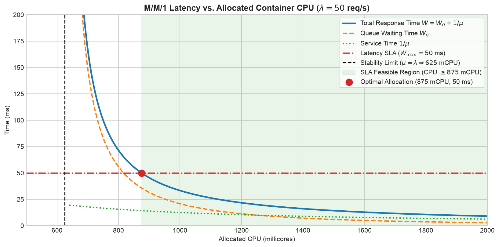
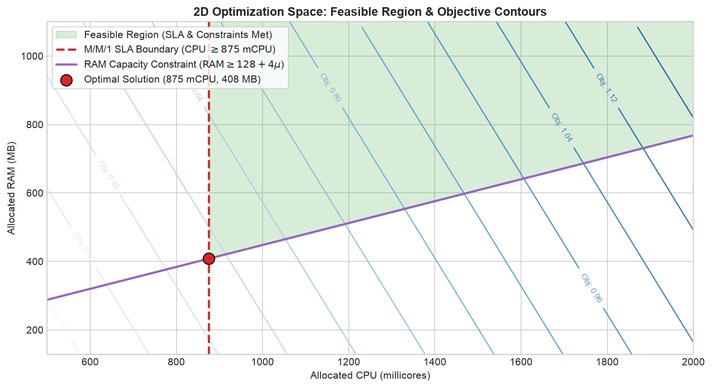
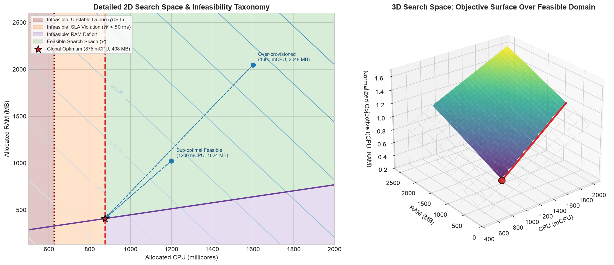
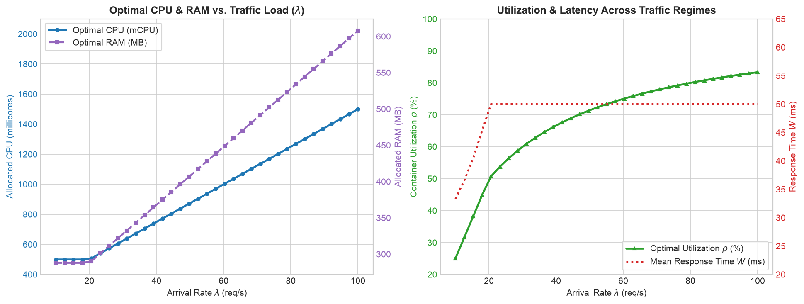
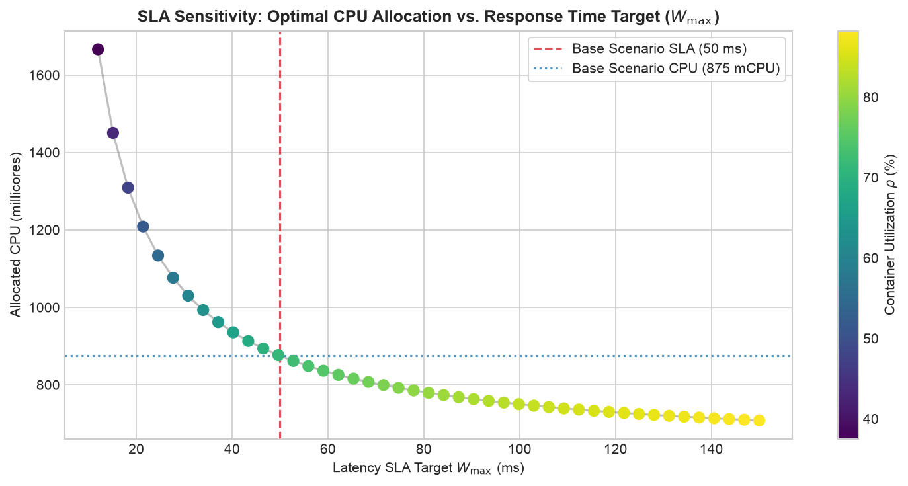

# Part 1: Single-Container Vertical Scaling via Queueing Theory (M/M/1)

> **Compendium of Container Resource Optimization in Cloud Systems**  
> *Part 1 of 3: Analytical Unidirectional Modeling (Single-Container Vertical Sizing)*

---

## Table of Contents
1. [Introduction and Engineering Context](#1-introduction-and-engineering-context)
2. [Theoretical Foundations: The M/M/1 Queueing Model](#2-theoretical-foundations-the-mm1-queueing-model)
   - [2.1 Poisson Arrival Processes](#21-poisson-arrival-processes)
   - [2.2 Service Capacity and Processor Speed](#22-service-capacity-and-processor-speed)
   - [2.3 Little's Law and Mean Response Time](#23-littles-law-and-mean-response-time)
   - [2.4 Stability Condition and Ergodicity](#24-stability-condition-and-ergodicity)
3. [Mathematical Formulation of the Optimization Problem](#3-mathematical-formulation-of-the-optimization-problem)
   - [3.1 Decision Variables](#31-decision-variables)
   - [3.2 System Parameters and Economic Weights](#32-system-parameters-and-economic-weights)
   - [3.3 Objective Function](#33-objective-function)
   - [3.4 Operational and SLA Constraints](#34-operational-and-sla-constraints)
   - [3.5 Exact Linear Reformulation: From Nonlinear (NLP) to Linear (LP)](#35-exact-linear-reformulation-from-nonlinear-nlp-to-linear-lp)
4. [Software Implementation Architecture in Python / Pyomo](#4-software-implementation-architecture-in-python--pyomo)
   - [4.1 Structure of `container_queue_model.py`](#41-structure-of-container_queue_modelpy)
   - [4.2 Supported Mathematical Solvers](#42-supported-mathematical-solvers)
5. [Numerical Analysis and Interpretation of Results](#5-numerical-analysis-and-interpretation-of-results)
   - [5.1 Benchmark Scenario Solved](#51-benchmark-scenario-solved)
   - [5.2 Steady-State Queueing Metrics at the Optimum](#52-steady-state-queueing-metrics-at-the-optimum)
   - [5.3 Sensitivity Analysis: Arrival Rate and Latency Slopes](#53-sensitivity-analysis-arrival-rate-and-latency-slopes)
6. [Execution Guide and Analysis Notebook](#6-execution-guide-and-analysis-notebook)
7. [Proposed Exercises and Extensions](#7-proposed-exercises-and-extensions)
8. [Bibliographical References](#8-bibliographical-references)

---

## 1. Introduction and Engineering Context

In modern cloud computing platforms (Kubernetes, Docker Swarm, Amazon ECS, Google Cloud Run), containerized microservices operate under stochastic and highly volatile request traffic. Site Reliability Engineers (SREs) and cloud platform architects face an ongoing **resource provisioning dilemma**:

- **Over-provisioning:** Allocating generous CPU cores and memory limits guarantees low latencies and strict compliance with Service Level Agreements (SLAs), but leads to massive financial waste and low cluster utilization.
- **Under-provisioning:** Aggressively shrinking CPU millicores and memory to minimize cloud spend triggers operating system thread scheduling delays, request backlog accumulation, explosive tail latencies, and container termination via Out-Of-Memory (OOM) killer events.

The objective of this **Part 1** is to formulate a rigorous mathematical model to determine the **exact optimal sizing**: finding the minimum CPU allocation (in millicores / mCPU) and memory allocation (in Megabytes) required for a single container instance to serve an incoming request rate $\lambda$ while mathematically guaranteeing that the mean system response time $W$ never exceeds a contractual SLA threshold $W_{\max}$.

---

## 2. Theoretical Foundations: The M/M/1 Queueing Model

To analytically model the request flow arriving at and processed by an isolated container instance, we employ **Queueing Theory**, founded by A. K. Erlang and formalized by Leonard Kleinrock.

```
       Incoming Request Flow                Waiting Queue                Container Processor
     ========================> [  [req] [req] [req]  ] ----> (  CPU / RAM  ) ====> HTTP Responses
            Rate λ                     FIFO Buffer                  Rate μ
```

In Kendall's notation, this system is classified as an **M/M/1 Queue**:
- **M (Markovian / Memoryless Arrivals):** Requests arrive according to a homogeneous Poisson process with mean rate $\lambda$.
- **M (Markovian Service Times):** The time required by the container to process each request is exponentially distributed with mean rate $\mu$.
- **1 (Single Server):** The container acts as a unified computing resource processing requests in First-In, First-Out (FIFO) discipline.

### 2.1 Poisson Arrival Processes

Let $N(t)$ denote the number of requests arriving at the container during the time interval $[0, t]$. The arrivals follow a Poisson distribution with arrival rate $\lambda$ ($\text{req/s}$):

$$P(N(t) = k) = \frac{(\lambda t)^k e^{-\lambda t}}{k!}, \quad k \in \{0, 1, 2, \dots\}$$

The inter-arrival times between successive requests $T_{\text{arr}}$ are independent and identically distributed (i.i.d.) continuous random variables governed by the exponential distribution:

$$f_{T_{\text{arr}}}(t) = \lambda e^{-\lambda t}, \quad t \ge 0, \quad \mathbb{E}[T_{\text{arr}}] = \frac{1}{\lambda}$$

### 2.2 Service Capacity and Processor Speed

The service time $T_{\text{serv}}$ of a request represents the compute time expended by the container CPU to execute application instructions, deserialize payloads, and generate HTTP responses. In classical queueing models, $T_{\text{serv}} \sim \text{Exp}(\mu)$, where the service capacity $\mu$ ($\text{req/s}$) is proportional to the compute quota provisioned to the container:

$$\mu = \alpha_{\text{cpu}} \cdot \text{CPU}$$

where:
- $\text{CPU}$ is the processing allocation in *millicores* ($1000\text{ mCPU} = 1\text{ virtual core / vCPU}$).
- $\alpha_{\text{cpu}}$ is the software throughput efficiency factor, measured in $\text{req/s}$ per millicore (e.g., $\alpha_{\text{cpu}} = 0.08\text{ req/s/mCPU}$ implies that every $100\text{ mCPU}$ sustains an average throughput of $8\text{ req/s}$).

### 2.3 Little's Law and Mean Response Time

Let $\rho$ denote the **traffic intensity** or **processor utilization**:

$$\rho = \frac{\lambda}{\mu}$$

Under the stationary regime of an M/M/1 queue:
1. **Mean number of requests in the system ($L$ - queue + server):**
   $$L = \frac{\rho}{1 - \rho} = \frac{\lambda}{\mu - \lambda}$$

2. **Little's Law ($L = \lambda W$):**
   The mean total residence time of a request within the container ($W$, consisting of queue waiting time $W_q$ plus service time $1/\mu$) is given by:
   $$W = \frac{L}{\lambda} = \frac{1}{\mu - \lambda}$$

3. **Mean waiting time in the queue ($W_q$):**
   $$W_q = W - \frac{1}{\mu} = \frac{\lambda}{\mu (\mu - \lambda)}$$

4. **Mean number of requests waiting in the queue ($L_q$):**
   $$L_q = \lambda W_q = \frac{\lambda^2}{\mu (\mu - \lambda)}$$

### 2.4 Stability Condition and Ergodicity

For the queueing system to be ergodic and admit a steady-state stationary distribution (preventing the buffer from growing indefinitely toward buffer overflow), the service rate must strictly exceed the arrival rate:

$$\mu > \lambda \iff \rho = \frac{\lambda}{\mu} < 1$$

If $\mu \le \lambda$, the system is unstable, queue length diverges ($\lim_{t \to \infty} L(t) = \infty$), and response times blow up to infinity.


*Figure 1.1: M/M/1 Total Response Time ($W$), Queue Waiting Time ($W_q$), and Service Time ($1/\mu$) as a function of allocated CPU.*

---

## 3. Mathematical Formulation of the Optimization Problem

### 3.1 Decision Variables

The optimization model determines three continuous decision variables:
- $\text{CPU} \in [\text{CPU}_{\min}, \text{CPU}_{\max}]$: Processing capacity in millicores (e.g., $[500, 2000]\text{ mCPU}$).
- $\text{RAM} \in [\text{RAM}_{\min}, \text{RAM}_{\max}]$: Memory capacity in Megabytes (e.g., $[128, 4096]\text{ MB}$).
- $\mu \in \mathbb{R}_+$: Resulting container service rate in requests per second ($\text{req/s}$).

### 3.2 System Parameters and Economic Weights

| Parameter | Symbol | Unit | Description |
| :--- | :---: | :---: | :--- |
| Arrival Rate | $\lambda$ | $\text{req/s}$ | Mean incoming request workload |
| Maximum Latency SLA | $W_{\max}$ | $\text{s}$ or $\text{ms}$ | Contractual upper bound on mean response time |
| CPU Throughput Coefficient | $\alpha_{\text{cpu}}$ | $\text{req/s/mCPU}$ | Code efficiency: service capacity per millicore |
| Base Memory Overhead | $\text{RAM}_{\text{base}}$ | $\text{MB}$ | Static memory occupied by runtime, JVM, OS layers |
| Dynamic Memory Factor | $\beta_{\text{ram}}$ | $\text{MB/}(\text{req/s})$ | Working set memory required per unit of throughput |
| Objective Weights | $w_{\text{cpu}}, w_{\text{ram}}$ | dimensionless | Cost weights normalizing relative economic values |

### 3.3 Objective Function

The objective is to minimize total container hardware cost. Because CPU and RAM span different orders of magnitude ($100$s of millicores vs. $1000$s of megabytes), both quantities are normalized by their respective maximum upper bounds:

$$\min_{\text{CPU}, \text{RAM}, \mu} \quad f(\text{CPU}, \text{RAM}) = w_{\text{cpu}} \left( \frac{\text{CPU}}{\text{CPU}_{\max}} \right) + w_{\text{ram}} \left( \frac{\text{RAM}}{\text{RAM}_{\max}} \right)$$

### 3.4 Operational and SLA Constraints

1. **Service Capacity Relation:**
   $$\mu = \alpha_{\text{cpu}} \cdot \text{CPU}$$

2. **Memory Dimensioning Proportional to Concurrency:**
   $$\text{RAM} \ge \text{RAM}_{\text{base}} + \beta_{\text{ram}} \cdot \mu$$

3. **Response Time SLA and Stability:**
   $$W = \frac{1}{\mu - \lambda} \le W_{\max}$$
   along with the strict ergodicity requirement:
   $$\mu > \lambda$$

4. **Resource Bounds:**
   $$\text{CPU}_{\min} \le \text{CPU} \le \text{CPU}_{\max}$$
   $$\text{RAM}_{\min} \le \text{RAM} \le \text{RAM}_{\max}$$

### 3.5 Exact Linear Reformulation: From Nonlinear (NLP) to Linear (LP)

The raw SLA constraint:

$$\frac{1}{\mu - \lambda} \le W_{\max}$$

is strictly **nonlinear and hyperbolic**. While Nonlinear Programming (NLP) solvers such as **Ipopt** can solve this via Primal-Dual Interior Point methods, nonlinear formulations introduce unnecessary computational overhead.

Because $W_{\max} > 0$ and under stability $\mu - \lambda > 0$, taking the reciprocal of both sides preserves the validity of the feasible domain:

$$\frac{1}{\mu - \lambda} \le W_{\max} \iff \mu - \lambda \ge \frac{1}{W_{\max}} \iff \mu \ge \lambda + \frac{1}{W_{\max}}$$

> [!IMPORTANT]
> **Property of the Exact Linear Reformulation:**
> The constraint $\mu - \lambda \ge \frac{1}{W_{\max}}$ is **strictly linear**. Furthermore, because $W_{\max} > 0$, the term $\frac{1}{W_{\max}} > 0$, which automatically ensures:
> $$\mu \ge \lambda + \frac{1}{W_{\max}} > \lambda$$
> Therefore, this single linear inequality simultaneously guarantees compliance with the latency SLA and ergodic stability ($\rho < 1$) without requiring open-interval bounds. The model is an **exact Continuous Linear Program (LP)** solvable in sub-millisecond time with certified global optimality.

---

## 4. Software Implementation Architecture in Python / Pyomo

The optimization model is implemented in [`container_queue_model.py`](./container_queue_model.py) using **Pyomo**, an enterprise-grade algebraic modeling library for Python.

```
       [ Input Workload & SLA Parameters ]
            λ, W_max, α_cpu, β_ram
                      │
                      ▼
       ┌───────────────────────────────┐
       │ build_container_queue_model() │  ---> Instantiates pyo.ConcreteModel
       │ - Sets Decision Variables     │
       │ - Adds LP / NLP Constraints   │
       │ - Sets Weighted Cost Function │
       └──────────────┬────────────────┘
                      │
                      ▼
       ┌───────────────────────────────┐
       │ solve_container_queue_model() │  ---> Dispatches to solver (HiGHS / Ipopt)
       └──────────────┬────────────────┘
                      │
                      ▼
       ┌───────────────────────────────┐
       │ extract_solution()            │  ---> Computes queueing metrics (W, Wq, L, ρ)
       └───────────────────────────────┘
```

### 4.1 Structure of `container_queue_model.py`

- `build_container_queue_model(...)`: Assembles the symbolic Pyomo algebraic model, allowing toggling between the exact linear formulation (`nonlinear=False`) and the raw hyperbolic constraint (`nonlinear=True`).
- `solve_container_queue_model(...)`: Automated solver orchestration searching for installed high-performance solvers (`appsi_highs`, `highs`, `glpk`, `ipopt`).
- `extract_solution(...)`: Reads the optimal decision vectors and calculates steady-state queueing metrics.
- `solve_and_report(...)`: Formatted CLI output report.

### 4.2 Supported Mathematical Solvers

1. **HiGHS (`appsi_highs` or `highs`):**
   State-of-the-art open-source solver for LP and MILP. Default choice for `nonlinear=False`.
2. **Ipopt (`ipopt`):**
   Nonlinear interior-point optimizer used when verifying the nonlinear formulation directly (`nonlinear=True`).

---

## 5. Numerical Analysis and Interpretation of Results

### 5.1 Benchmark Scenario Solved

Consider a production container hosting a core microservice API:
- **Arrival Rate ($\lambda$):** $50.00\text{ req/s}$
- **Latency SLA ($W_{\max}$):** $50.00\text{ ms} = 0.0500\text{ s}$
- **CPU Throughput ($\alpha_{\text{cpu}}$):** $0.08\text{ req/s/mCPU}$
- **Base Memory ($\text{RAM}_{\text{base}}$):** $128.00\text{ MB}$
- **RAM Scaling Factor ($\beta_{\text{ram}}$):** $4.00\text{ MB/}(\text{req/s})$
- **Cost Weights:** $w_{\text{cpu}} = 1.0, w_{\text{ram}} = 1.0$

Analytical resolution:

$$\mu^* = \lambda + \frac{1}{W_{\max}} = 50.00 + \frac{1}{0.0500} = 50.00 + 20.00 = 70.00\text{ req/s}$$

Optimal hardware allocation:

$$\text{CPU}^* = \frac{\mu^*}{\alpha_{\text{cpu}}} = \frac{70.00}{0.08} = 875.00\text{ mCPU}$$

$$\text{RAM}^* = \text{RAM}_{\text{base}} + \beta_{\text{ram}} \cdot \mu^* = 128.00 + (4.00 \times 70.00) = 408.00\text{ MB}$$

### 5.2 Steady-State Queueing Metrics at the Optimum

With this optimal provisioning:
- **Utilization ($\rho$):**
  $$\rho = \frac{50.00}{70.00} \approx 71.43\%$$
- **Mean System Response Time ($W$):**
  $$W = \frac{1}{70.00 - 50.00} = \frac{1}{20.00} = 0.0500\text{ s} = 50.00\text{ ms} \quad (\text{Precisely hits the SLA bound})$$
- **Mean Queue Waiting Time ($W_q$):**
  $$W_q = W - \frac{1}{\mu^*} = 0.0500 - \frac{1}{70.00} = 35.71\text{ ms}$$
- **Mean Waiting Requests in Queue ($L_q$):**
  $$L_q = \lambda W_q = 50.00 \times 0.03571 \approx 1.79\text{ requests}$$
- **Mean Requests in System ($L$):**
  $$L = \lambda W = 50.00 \times 0.0500 = 2.50\text{ requests}$$


*Figure 1.2: 2D Optimization Space in the CPU-RAM plane, displaying the M/M/1 SLA boundary and objective contours.*


*Figure 1.3: Comprehensive 2D Search Space Infeasibility Taxonomy (left) and 3D Objective Surface over the feasible domain (right).*

### 5.3 Sensitivity Analysis: Arrival Rate and Latency Slopes

In [`container_queue_analysis.ipynb`](./container_queue_analysis.ipynb), sensitivity curves illustrate the nonlinear response of queueing dynamics:

1. **Latency Asymptote:** As $\rho \to 1$, response times explode hyperbolically ($W \to \infty$). To keep latency constant under rising load $\lambda$, container capacity must grow linearly with $\lambda$, maintaining a constant capacity headroom of $\frac{1}{W_{\max}}$ units.
2. **The Cost of Stringent SLAs:** Tightening the SLA (e.g., from $50\text{ ms}$ down to $10\text{ ms}$) requires a discrete jump in compute capacity:
   $$\Delta \mu = \frac{1}{0.010} - \frac{1}{0.050} = 100 - 20 = 80\text{ req/s} \implies \Delta \text{CPU} = \frac{80}{0.08} = 1000\text{ mCPU}$$
   Achieving a 5x lower latency SLA demands allocating an entire additional vCPU core simply to compress the queue waiting buffer!


*Figure 1.4: Optimal CPU and RAM scaling trajectory alongside container utilization across varying arrival rates ($\lambda$).*


*Figure 1.5: Sensitivity of optimal container CPU allocation to the latency SLA threshold ($W_{\max}$).*

---

## 6. Execution Guide and Analysis Notebook

### 6.1 Running via Command Line (Python Script)

Execute the solver with default parameters:

```bash
uv run python part1/container_queue_model.py
```

Or from inside the directory:

```bash
cd part1
uv run python container_queue_model.py
```

### 6.2 Interactive Exploration in Jupyter Notebook

The notebook [`container_queue_analysis.ipynb`](./container_queue_analysis.ipynb) provides:
- 3D surface plot of the resource cost function;
- Feasible region contour overlay showing the SLA boundary;
- Workload sensitivity sweep with $\lambda \in [10, 100]\text{ req/s}$;
- SLA trade-off curves contrasting hardware cost against target latency.

Launch Jupyter Lab:

```bash
uv run jupyter lab part1/container_queue_analysis.ipynb
```

---

## 7. Proposed Exercises and Extensions

1. **Memory Weight Sensitivity:**  
   If cloud memory prices double relative to CPU ($w_{\text{ram}} = 2.0, w_{\text{cpu}} = 1.0$), does the optimal allocation point $(\text{CPU}^*, \text{RAM}^*)$ shift? *(Hint: examine the active constraints at the boundary).*
2. **Service Variance and M/G/1 Systems:**  
   If service time exhibits heavy variance (coefficient of variation $C_v > 1$), how does the Pollaczek-Khinchine formula for M/G/1 queues alter the required CPU headroom for the same SLA?
3. **Upper Bound Satiation:**  
   Suppose incoming traffic surges to $\lambda = 150\text{ req/s}$. The required CPU exceeds $\text{CPU}_{\max} = 2000\text{ mCPU}$. What is the absolute maximum traffic a single container can handle before SLA violation? *(This motivates Part 2: Multiple Replicas).*

---

## 8. Bibliographical References

1. **Kleinrock, Leonard.** *Queueing Systems, Volume 1: Theory*. John Wiley & Sons, 1975.
2. **Harchol-Balter, Mor.** *Performance Modeling and Design of Computer Systems: Queueing Theory in Action*. Cambridge University Press, 2013.
3. **Boyd, Stephen, & Vandenberghe, Lieven.** *Convex Optimization*. Cambridge University Press, 2004.
4. **Bynum, M. L., et al.** *Pyomo — Optimization Modeling in Python*. 3rd Edition, Springer, 2021.
5. **Burns, Brendan.** *Designing Distributed Systems: Patterns and Paradigms for Scalable, Reliable Services*. O'Reilly Media, 2018.
