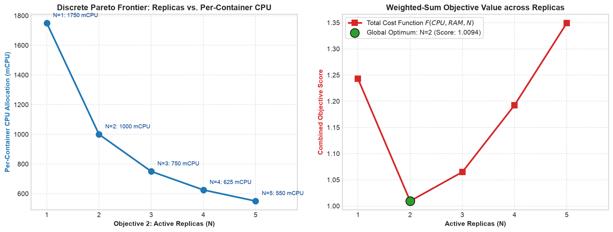
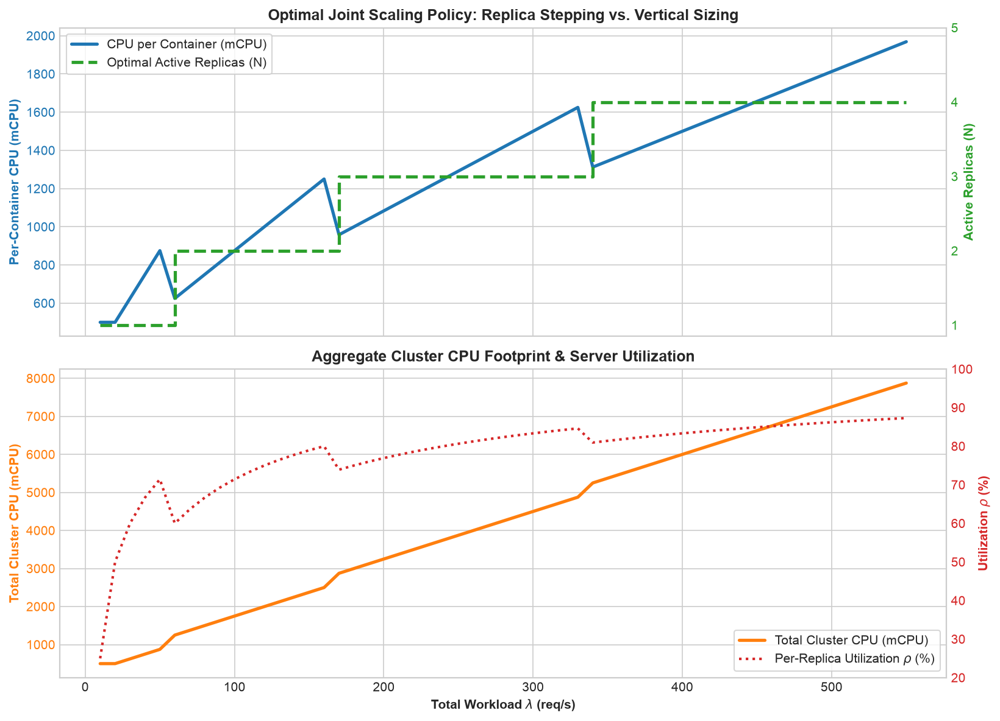
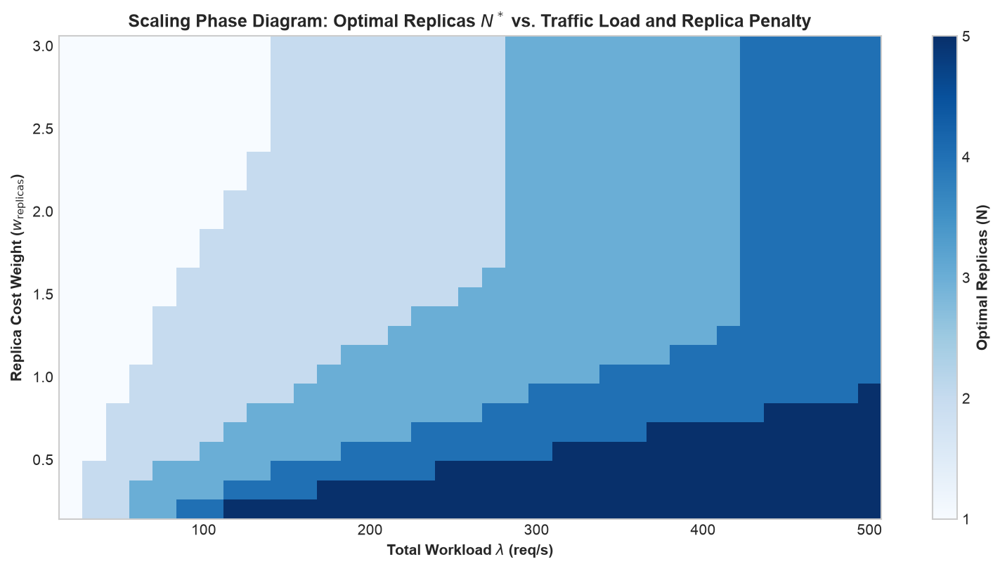
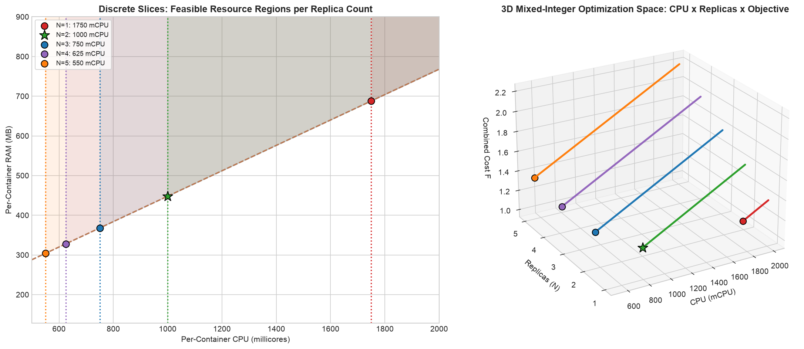

# Part 2: Joint Horizontal and Vertical Scaling (Parallel M/M/1 Queues & MILP)

> **Compendium of Container Resource Optimization in Cloud Systems**  
> *Part 2 of 3: Multi-Objective Replica & Resource Optimization (Horizontal + Vertical Scaling)*

---

## Table of Contents
1. [Introduction and Distributed Architecture Challenges](#1-introduction-and-distributed-architecture-challenges)
   - [1.1 Scale-Up vs. Scale-Out](#11-scale-up-vs-scale-out)
   - [1.2 Architectural Trade-Offs](#12-architectural-trade-offs)
2. [Theoretical Foundations: Parallel M/M/1 Queues and Load Balancing](#2-theoretical-foundations-parallel-mm1-queues-and-load-balancing)
   - [2.1 The Poisson Splitting Theorem](#21-the-poisson-splitting-theorem)
   - [2.2 Steady-State Dynamics of Homogeneous Replicas](#22-steady-state-dynamics-of-homogeneous-replicas)
   - [2.3 Aggregate Cluster Metrics](#23-aggregate-cluster-metrics)
3. [Mathematical Formulation of the Multi-Objective Problem](#3-mathematical-formulation-of-the-multi-objective-problem)
   - [3.1 Decision Variables (Continuous and Discrete)](#31-decision-variables-continuous-and-discrete)
   - [3.2 Competing Objective Functions](#32-competing-objective-functions)
   - [3.3 Exact Linearization of Load Splitting via Indicator Variables (MILP)](#33-exact-linearization-of-load-splitting-via-indicator-variables-milp)
   - [3.4 Complete Mixed-Integer Linear Program (MILP)](#34-complete-mixed-integer-linear-program-milp)
4. [Software Implementation Architecture in Python / Pyomo](#4-software-implementation-architecture-in-python--pyomo)
   - [4.1 Structure of `container_replicas_queue_model.py`](#41-structure-of-container_replicas_queue_modelpy)
   - [4.2 Pareto Frontier Sweep and Fixed-Replica Evaluation](#42-pareto-frontier-sweep-and-fixed-replica-evaluation)
5. [Numerical Analysis and Discussion of Results](#5-numerical-analysis-and-discussion-of-results)
   - [5.1 High-Load Benchmark Scenario ($\lambda = 120\text{ req/s}$)](#51-high-load-benchmark-scenario-lambda--120text-reqs)
   - [5.2 Detailed Comparison Across Replicas ($N=1$ to $N=5$)](#52-detailed-comparison-across-replicas-n1-to-n5)
   - [5.3 Cluster Fragmentation and the "Replica Tax"](#53-cluster-fragmentation-and-the-replica-tax)
6. [Execution Guide and Analysis Notebook](#6-execution-guide-and-analysis-notebook)
7. [Proposed Exercises and Extensions](#7-proposed-exercises-and-extensions)
8. [Bibliographical References](#8-bibliographical-references)

---

## 1. Introduction and Distributed Architecture Challenges

In [Part 1](../part1/README.md), we established the mathematical model for sizing a single container instance. However, production cloud environments impose hard physical and architectural constraints on single-container scaling:

1. **Host Node Satiation:** A container cannot scale beyond the physical CPU and memory limits of the underlying worker node (e.g., standard cloud VMs capped at 4 or 8 vCPUs).
2. **Single Point of Failure (SPOF):** Running a single monolithic container exposes the service to complete outages during node evictions, rolling updates, or hardware kernel panics.
3. **Application Concurrency Bottlenecks:** Many language runtimes (Node.js event loops, Python GIL, JVM GC stop-the-world pauses) encounter severe internal lock contention when provisioned with more than 1 or 2 CPU cores.

```
                            [ Load Balancer (Ingress / Envoy) ]
                                      λ = 120 req/s
                                    /       |       \
                     λ/N = 60 req/s/        |        \λ/N = 60 req/s
                                  /         |         \
                                 ▼          ▼          ▼
                          ┌──────────┐ ┌──────────┐ ┌──────────┐
                          │Replica 1 │ │Replica 2 │ │Replica N │
                          │ (M/M/1)  │ │ (M/M/1)  │ │ (M/M/1)  │
                          └──────────┘ └──────────┘ └──────────┘
```

These operational realities demand **Horizontal Scaling (Scale-Out)**: distributing the aggregate incoming traffic across $N$ homogeneous container replicas coordinated behind an HTTP reverse proxy or load balancer.

### 1.1 Scale-Up vs. Scale-Out

- **Vertical Scaling (Scale-Up):** Adjusts the per-container resource sizing ($\text{CPU}$ and $\text{RAM}$). Minimizes cluster scheduling overhead and avoids duplicating baseline runtime memory ($\text{RAM}_{\text{base}}$), but reaches concurrency plateaus and lacks fault tolerance.
- **Horizontal Scaling (Scale-Out):** Adjusts the number of active replicas ($N \in \{1, \dots, N_{\max}\}$). Provides high availability, isolates failures, and divides incoming load, but introduces inter-service communication overhead and multiplies base memory overhead by $N$.

### 1.2 Architectural Trade-Offs

When configuring autoscaling systems such as the Kubernetes Horizontal Pod Autoscaler (HPA) and Vertical Pod Autoscaler (VPA), operators must answer a central question:

> **Core Architectural Dilemma:**
> *To satisfy a traffic volume of $\lambda = 120\text{ req/s}$ with latency $W \le 50\text{ ms}$, should we provision 1 large container of $1750\text{ mCPU}$, 2 balanced containers of $1000\text{ mCPU}$, or 5 small containers of $550\text{ mCPU}$?*

This part formulates this decision as a **Multi-Objective Mixed-Integer Linear Programming (MILP)** optimization problem.

---

## 2. Theoretical Foundations: Parallel M/M/1 Queues and Load Balancing

### 2.1 The Poisson Splitting Theorem

Consider an aggregate stream of HTTP requests arriving at a load balancer according to a homogeneous Poisson process with rate $\lambda$. The load balancer implements an unbiased routing policy (e.g., stateless Round-Robin or uniform random routing) dispatching each incoming request to replica $i \in \{1, \dots, N\}$ with equal probability $p = \frac{1}{N}$.

By the **Poisson Decomposition (Splitting) Theorem**:
> If a Poisson process with rate $\lambda$ is split into $N$ mutually exclusive streams with selection probabilities $p_1, \dots, p_N$ (such that $\sum_{i=1}^N p_i = 1$), each split stream $i$ is **an independent Poisson process** with mean arrival rate:
> $$\lambda_i = p_i \cdot \lambda = \frac{\lambda}{N}$$

Consequently, each replica operates as an **independent M/M/1 queue** receiving an exact partition of the global traffic:

$$\lambda_{\text{rep}} = \frac{\lambda}{N}$$

### 2.2 Steady-State Dynamics of Homogeneous Replicas

Assuming all $N$ replicas are configured with identical hardware allocations ($\text{CPU}$ and $\text{RAM}$), each replica delivers service capacity:

$$\mu = \alpha_{\text{cpu}} \cdot \text{CPU}$$

The per-replica utilization is:

$$\rho_{\text{rep}} = \frac{\lambda_{\text{rep}}}{\mu} = \frac{\lambda}{N \cdot \mu} < 1$$

The mean response time experienced by any request processed by replica $i$ is governed by the M/M/1 formula:

$$W = \frac{1}{\mu - \lambda_{\text{rep}}} = \frac{1}{\mu - \frac{\lambda}{N}}$$

To ensure SLA compliance across the entire distributed cluster, every replica must satisfy:

$$W \le W_{\max} \iff \mu - \frac{\lambda}{N} \ge \frac{1}{W_{\max}}$$

### 2.3 Aggregate Cluster Metrics

By linearity of expectation and Little's Law applied across the cluster:
- **Total cluster processing capacity:** $\mu_{\text{cluster}} = N \cdot \mu$
- **Total requests present in the cluster ($L_{\text{cluster}}$):**
  $$L_{\text{cluster}} = N \cdot L_{\text{rep}} = N \left( \frac{\lambda_{\text{rep}}}{\mu - \lambda_{\text{rep}}} \right) = \frac{\lambda}{\mu - \frac{\lambda}{N}} = \lambda W$$
- **Total cluster CPU footprint:** $\text{CPU}_{\text{cluster}} = N \cdot \text{CPU}$
- **Total cluster RAM footprint:** $\text{RAM}_{\text{cluster}} = N \cdot \text{RAM}$

---

## 3. Mathematical Formulation of the Multi-Objective Problem

### 3.1 Decision Variables (Continuous and Discrete)

The problem incorporates both continuous and discrete optimization variables:
- **Continuous Variables:**
  - $\text{CPU} \in [\text{CPU}_{\min}, \text{CPU}_{\max}]$: Processing millicores allocated per container replica.
  - $\text{RAM} \in [\text{RAM}_{\min}, \text{RAM}_{\max}]$: Memory in Megabytes allocated per container replica.
  - $\mu \ge 0$: Service capacity per replica ($\text{req/s}$).
  - $\lambda_{\text{rep}} \ge 0$: Dispatched arrival rate per replica ($\text{req/s}$).
- **Discrete Integer Variable:**
  - $N \in \{1, 2, \dots, N_{\max}\}$: Active container replica count (e.g., $N_{\max} = 5$).
- **Binary Indicator Variables:**
  - $z_n \in \{0, 1\}$ for $n \in \{1, \dots, N_{\max}\}$: Binary selection variable where $z_n = 1 \iff N = n$.

### 3.2 Competing Objective Functions

The system designer faces two opposing cost forces:
1. **Objective 1 ($f_1$ - Per-Container Hardware Footprint):** Minimize vertical sizing:
   $$f_1(\text{CPU}, \text{RAM}) = w_{\text{cpu}} \left( \frac{\text{CPU}}{\text{CPU}_{\max}} \right) + w_{\text{ram}} \left( \frac{\text{RAM}}{\text{RAM}_{\max}} \right)$$

2. **Objective 2 ($f_2$ - Active Replica Multiplicity):** Minimize the number of concurrent pods (reducing service mesh traffic, cluster coordination overhead, connection pool limits):
   $$f_2(N) = \frac{N}{N_{\max}}$$

We scalarize the multi-objective problem via the **Weighted-Sum Method**:

$$\min_{\text{CPU}, \text{RAM}, N, z} \quad F = w_{\text{resources}} \cdot f_1(\text{CPU}, \text{RAM}) + w_{\text{replicas}} \cdot f_2(N)$$

### 3.3 Exact Linearization of Load Splitting via Indicator Variables (MILP)

The per-replica arrival rate equation:

$$\lambda_{\text{rep}} = \frac{\lambda}{N}$$

is non-convex and non-linear, as the decision variable $N$ resides in the denominator. Solving this directly would require a Mixed-Integer Nonlinear Programming (MINLP) solver, which is susceptible to local optima.

Because the allowable replica counts form a small discrete set $\{1, \dots, N_{\max}\}$, we employ an **exact multiple-choice linearization**:

1. Define binary indicators $z_n \in \{0, 1\}$ for each candidate replica count $n \in \{1, \dots, N_{\max}\}$.
2. Enforce exactly one active choice:
   $$\sum_{n=1}^{N_{\max}} z_n = 1$$
3. Couple the integer replica count $N$ to the active indicator:
   $$N = \sum_{n=1}^{N_{\max}} n \cdot z_n$$
4. Express the partitioned arrival rate as an exact linear combination of pre-computed constants $\left(\frac{\lambda}{n}\right)$:
   $$\lambda_{\text{rep}} = \sum_{n=1}^{N_{\max}} \left(\frac{\lambda}{n}\right) z_n$$

> [!NOTE]
> This reformulation eliminates the non-linear quotient entirely, converting the problem into a **pure Mixed-Integer Linear Program (MILP)** solvable to proven global optimality using standard branch-and-bound techniques.

### 3.4 Complete Mixed-Integer Linear Program (MILP)

$$\min \quad w_{\text{resources}} \left[ w_{\text{cpu}} \left(\frac{\text{CPU}}{\text{CPU}_{\max}}\right) + w_{\text{ram}} \left(\frac{\text{RAM}}{\text{RAM}_{\max}}\right) \right] + w_{\text{replicas}} \left(\frac{N}{N_{\max}}\right)$$

subject to:
$$\sum_{n=1}^{N_{\max}} z_n = 1, \quad z_n \in \{0, 1\} \quad \forall n \in \{1, \dots, N_{\max}\}$$
$$N = \sum_{n=1}^{N_{\max}} n \cdot z_n$$
$$\lambda_{\text{rep}} = \sum_{n=1}^{N_{\max}} \left(\frac{\lambda}{n}\right) z_n$$
$$\mu = \alpha_{\text{cpu}} \cdot \text{CPU}$$
$$\text{RAM} \ge \text{RAM}_{\text{base}} + \beta_{\text{ram}} \cdot \mu$$
$$\mu - \lambda_{\text{rep}} \ge \frac{1}{W_{\max}}$$
$$\text{CPU}_{\min} \le \text{CPU} \le \text{CPU}_{\max}, \quad \text{RAM}_{\min} \le \text{RAM} \le \text{RAM}_{\max}$$

---

## 4. Software Implementation Architecture in Python / Pyomo

The model is implemented in [`container_replicas_queue_model.py`](./container_replicas_queue_model.py).

```
         Workload Input: λ = 120 req/s, W_max = 0.05 s, Weights (w_res, w_rep)
                                      │
                                      ▼
                  ┌────────────────────────────────────────┐
                  │   build_container_replicas_model()     │
                  │   - Instantiates Replica Set {1..5}    │
                  │   - Defines Continuous Vars & z[n]     │
                  │   - Builds MILP Linearization Eqns     │
                  │   - Assembles Weighted-Sum Objective   │
                  └───────────────────┬────────────────────┘
                                      │
                                      ▼
                  ┌────────────────────────────────────────┐
                  │   solve_container_replicas_model()     │
                  │   - Solves via HiGHS Branch-and-Bound  │
                  └───────────────────┬────────────────────┘
                                      │
                                      ▼
                  ┌────────────────────────────────────────┐
                  │   extract_solution()                   │
                  │   - Extracts N*, CPU*, RAM*, mu*, W, ρ │
                  │   - Computes Aggregate Cluster Totals  │
                  └────────────────────────────────────────┘
```

### 4.1 Structure of `container_replicas_queue_model.py`

- `build_container_replicas_model(...)`: Assembles the Pyomo MILP model, supporting an optional `fixed_replicas` parameter to constrain the search to a specific replica count.
- `solve_container_replicas_model(...)`: Dispatches the model to the HiGHS MILP solver (`appsi_highs` or `highs`).
- `evaluate_replica_options(...)`: Solves the optimization problem for each $N \in [1, 5]$ individually, generating a comparative trade-off matrix.
- `extract_solution(...)`: Formats per-replica and aggregate cluster metrics into structured dataclasses.

### 4.2 Pareto Frontier Sweep and Fixed-Replica Evaluation

By iteratively constraining $z_n = 1$ across $n \in \{1, \dots, 5\}$, the script maps out the complete discrete Pareto front between per-container resource sizing and horizontal pod count.

---

## 5. Numerical Analysis and Discussion of Results

### 5.1 High-Load Benchmark Scenario ($\lambda = 120\text{ req/s}$)

System parameters:
- **Total Workload ($\lambda$):** $120.00\text{ req/s}$
- **Latency SLA ($W_{\max}$):** $50.00\text{ ms} = 0.0500\text{ s}$
- **Container Efficiency:** $\alpha_{\text{cpu}} = 0.08\text{ req/s/mCPU}$, $\text{RAM}_{\text{base}} = 128\text{ MB}$, $\beta_{\text{ram}} = 4.0\text{ MB/(req/s)}$
- **Operational Bounds:** $\text{CPU} \in [500, 2000]\text{ mCPU}$, $\text{RAM} \in [128, 4096]\text{ MB}$, $N \in [1, 5]$
- **Multi-Objective Weights:** $w_{\text{resources}} = 1.0$, $w_{\text{replicas}} = 1.0$

### 5.2 Detailed Comparison Across Replicas ($N=1$ to $N=5$)

Solving the model for each discrete candidate yields:

| Replicas ($N$) | Arrival/Replica ($\lambda_{\text{rep}}$) | CPU/Replica ($\text{mCPU}$) | RAM/Replica ($\text{MB}$) | Cluster CPU ($\text{mCPU}$) | Cluster RAM ($\text{MB}$) | Combined Objective |
| :---: | :---: | :---: | :---: | :---: | :---: | :---: |
| **1** | $120.0\text{ req/s}$ | $1750.00$ | $688.00$ | $1750.00$ | $688.00$ | $1.2430$ |
| **2 (Optimal)** | **$60.0\text{ req/s}$** | **$1000.00$** | **$448.00$** | **$2000.00$** | **$896.00$** | **$1.0094$** |
| **3** | $40.0\text{ req/s}$ | $750.00$ | $368.00$ | $2250.00$ | $1104.00$ | $1.0648$ |
| **4** | $30.0\text{ req/s}$ | $625.00$ | $328.00$ | $2500.00$ | $1312.00$ | $1.1926$ |
| **5** | $24.0\text{ req/s}$ | $550.00$ | $304.00$ | $2750.00$ | $1520.00$ | $1.3492$ |


*Figure 2.1: Discrete Pareto Frontier between active replica multiplicity ($N$) and per-container CPU allocation (left), and weighted-sum objective curve (right).*

### 5.3 Cluster Fragmentation and the "Replica Tax"

Key engineering takeaways from this numerical evaluation:

1. **The Global Optimum ($N^* = 2$):**
   The MILP solver identifies $N^* = 2$ replicas with **$1000\text{ mCPU}$** (1.0 vCPU) and **$448\text{ MB}$ of RAM** each as the best configuration. It avoids the oversized single pod of $N=1$ while resisting unnecessary replica proliferation.
2. **The "Replica Tax" on Capacity Headroom:**
   To guarantee an SLA of $50\text{ ms}$, each active queue requires a minimum capacity buffer of $\frac{1}{W_{\max}} = 20\text{ req/s} = 250\text{ mCPU}$ above its arrival rate:
   - For $N=1$, this headroom is paid once ($20\text{ req/s}$).
   - For $N=5$, this headroom is duplicated across all 5 queues ($5 \times 20 = 100\text{ req/s} = 1250\text{ mCPU}$ in total safety margins!).
   Furthermore, each replica duplicates the base OS/runtime memory of $128\text{ MB}$ ($640\text{ MB}$ static overhead for $N=5$ vs. $128\text{ MB}$ for $N=1$).
3. **Resilience vs. Efficiency:**
   Although $N=1$ has the lowest total cluster CPU ($1750\text{ mCPU}$ vs. $2000\text{ mCPU}$ for $N=2$), it offers zero fault tolerance. The optimal solution $N=2$ provides high availability at a modest $14\%$ CPU overhead.


*Figure 2.2: Joint Vertical & Horizontal Autoscaling Trajectory (top) and Aggregate Cluster CPU Footprint & Server Utilization (bottom).*


*Figure 2.3: Scaling Phase Diagram: Optimal replica count $N^*$ across varying total workloads and replica cost penalties.*


*Figure 2.4: 2D Feasible Slices per replica count (left) and 3D Mixed-Integer Optimization Space across CPU, Replicas, and Objective (right).*

---

## 6. Execution Guide and Analysis Notebook

### 6.1 Running via Command Line (Python Script)

Run the full MILP optimization and replica evaluation:

```bash
uv run python part2/container_replicas_queue_model.py
```

Or from inside the directory:

```bash
cd part2
uv run python container_replicas_queue_model.py
```

### 6.2 Interactive Exploration in Jupyter Notebook

The notebook [`container_replicas_queue_analysis.ipynb`](./container_replicas_queue_analysis.ipynb) provides:
- Visual comparison bar charts of the 5 replica options;
- Stacked cost component breakdowns (CPU vs. RAM vs. Replica Penalty);
- Discrete Pareto trade-off curve;
- Aggregate cluster footprint plots.

Launch Jupyter Lab:

```bash
uv run jupyter lab part2/container_replicas_queue_analysis.ipynb
```

---

## 7. Proposed Exercises and Extensions

1. **Varying Coordination Penalties:**  
   Change $w_{\text{replicas}} = 0.1$ while keeping $w_{\text{resources}} = 1.0$. Which replica count becomes optimal? Explain why clusters with cheap load balancers favor higher numbers of micro-containers.
2. **Load Balancer Transit Latency:**  
   If the load balancer introduces an ingress latency of $W_{\text{LB}} = 5\text{ ms}$, how must the per-replica SLA constraint be tightened so total end-to-end latency remains below $50\text{ ms}$?
3. **Stochastic Load Imbalance:**  
   If the load balancer exhibits session affinity (sticky sessions), causing one replica to receive $40\%$ of the traffic instead of $33.3\%$ when $N=3$, what is the required CPU sizing for that replica to prevent SLA breaches?

---

## 8. Bibliographical References

1. **Shortle, John F., et al.** *Fundamentals of Queueing Theory*. 5th Edition, John Wiley & Sons, 2018.
2. **Nemhauser, George L., & Wolsey, Laurence A.** *Integer and Combinatorial Optimization*. Wiley-Interscience, 1988.
3. **Miettinen, Kaisa.** *Nonlinear Multiobjective Optimization*. Springer Science & Business Media, 1999.
4. **Kubernetes Documentation.** *Horizontal Pod Autoscaling & Resource Management*. https://kubernetes.io/docs/tasks/run-application/horizontal-pod-autoscale/
5. **Beyer, Betsy, et al.** *Site Reliability Engineering: How Google Runs Production Systems*. O'Reilly Media, 2016.
