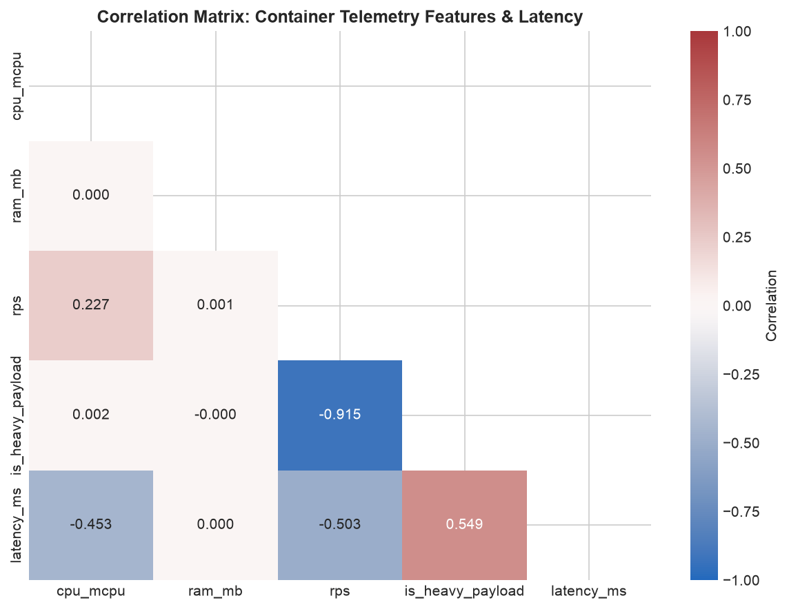
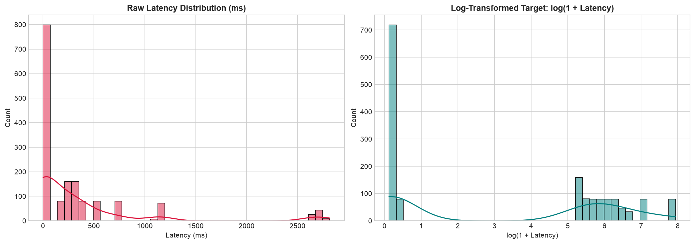
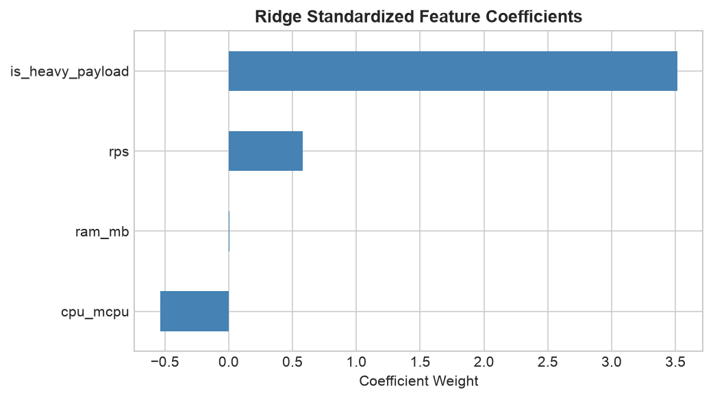
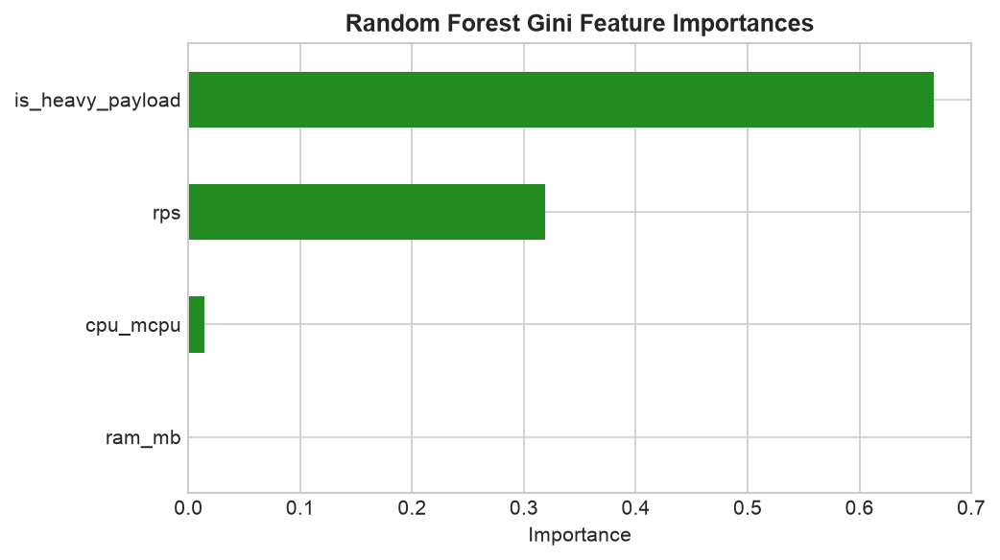
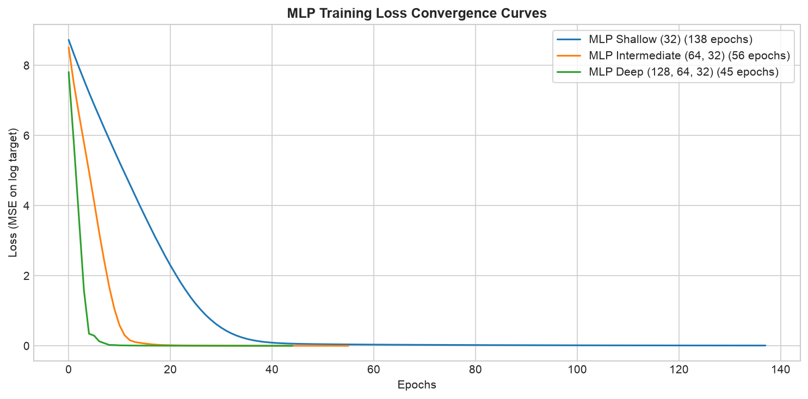
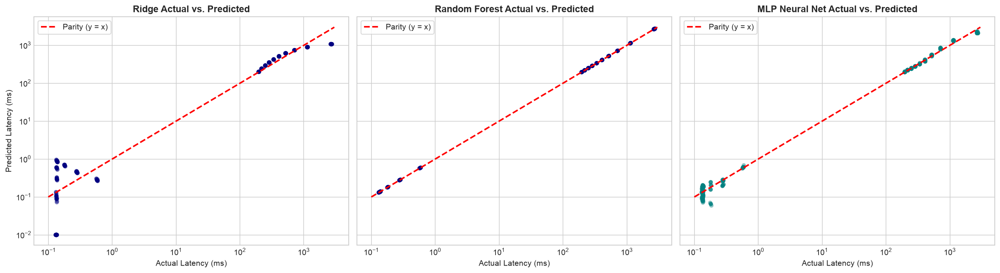
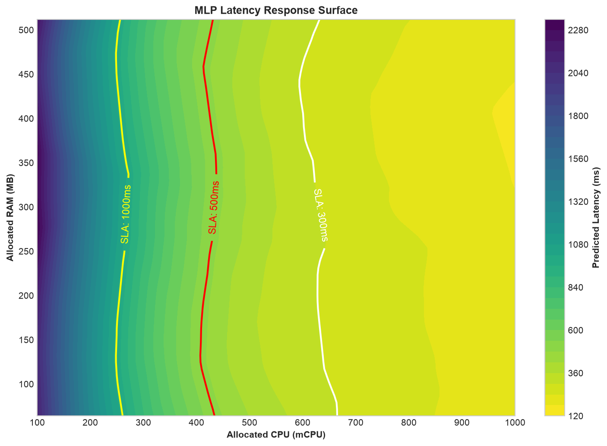
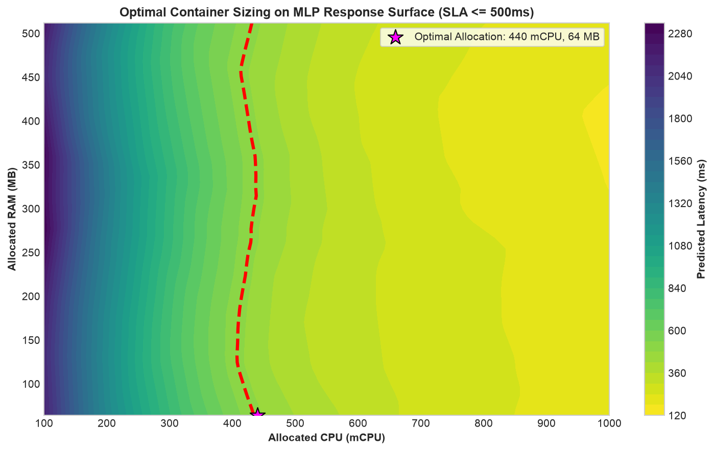
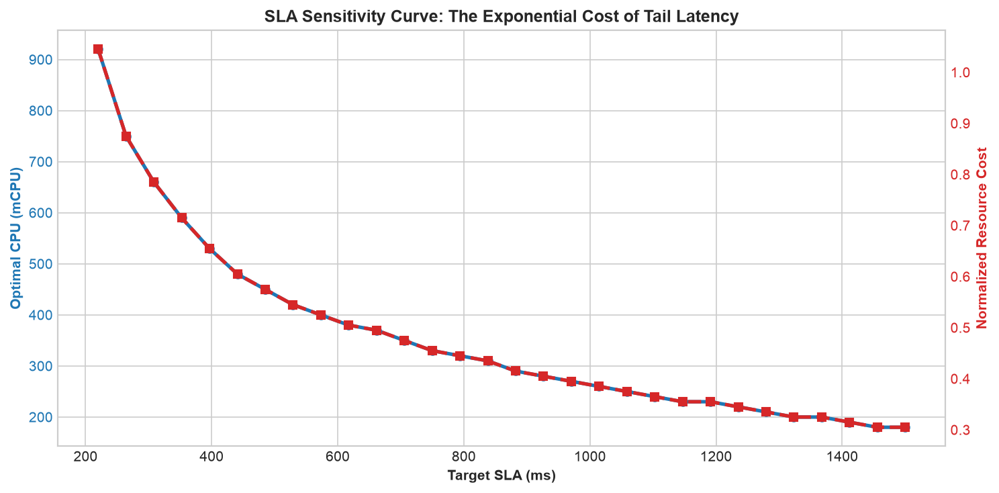
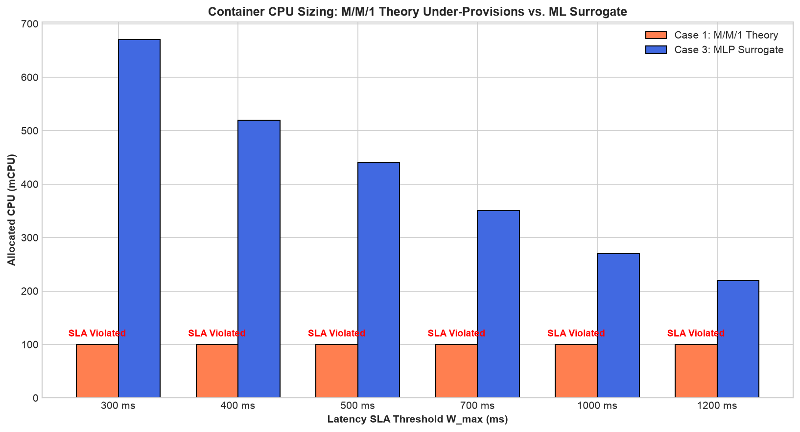

# Part 3: Data-Driven Resource Optimization via Machine Learning (ML Surrogates)

> **Compendium of Container Resource Optimization in Cloud Systems**  
> *Part 3 of 3: Empirical Latency Modeling & Neural Network Optimization (ML Surrogate Optimization)*

---

## Table of Contents
1. [Introduction: The Chasm Between Analytical Theory and Cloud Reality](#1-introduction-the-chasm-between-analytical-theory-and-cloud-reality)
   - [1.1 Why Classical M/M/1 Queues Fail in Production](#11-why-classical-mm1-queues-fail-in-production)
   - [1.2 Linux CFS Bandwidth Throttling](#12-linux-cfs-bandwidth-throttling)
   - [1.3 Memory Pressure, Page Cache Thrashing, and Garbage Collection](#13-memory-pressure-page-cache-thrashing-and-garbage-collection)
2. [Surrogate-Based Optimization Architecture](#2-surrogate-based-optimization-architecture)
   - [2.1 The Black-Box Latency Function](#21-the-black-box-latency-function)
   - [2.2 Constrained Optimization with an ML Oracle](#22-constrained-optimization-with-an-ml-oracle)
3. [The Production Telemetry Benchmark Dataset (UPB / Nginx)](#3-the-production-telemetry-benchmark-dataset-upb--nginx)
   - [3.1 Feature Schema and Observations](#31-feature-schema-and-observations)
   - [3.2 Heavy-Tailed Latency Distribution and Log-Transform](#32-heavy-tailed-latency-distribution-and-log-transform)
4. [Machine Learning Modeling and Training Pipeline](#4-machine-learning-modeling-and-training-pipeline)
   - [4.1 Regularized Ridge Regression (Linear Baseline)](#41-regularized-ridge-regression-linear-baseline)
   - [4.2 Random Forest Regressor (Non-Linear Ensemble)](#42-random-forest-regressor-non-linear-ensemble)
   - [4.3 Multi-Layer Perceptron (Deep Neural Network Surrogate)](#43-multi-layer-perceptron-deep-neural-network-surrogate)
   - [4.4 Cross-Validation Performance Comparison ($R^2$, MAE, RMSE)](#44-cross-validation-performance-comparison-r2-mae-rmse)
5. [The Learned Latency Response Surface and Optimization](#5-the-learned-latency-response-surface-and-optimization)
   - [5.1 2D Response Surface Contour Mapping](#51-2d-response-surface-contour-mapping)
   - [5.2 Formulation of the ML-Constrained Optimization Problem](#52-formulation-of-the-ml-constrained-optimization-problem)
   - [5.3 Resolution Algorithms: Adaptive Grid Search vs. SLSQP](#53-resolution-algorithms-adaptive-grid-search-vs-slsqp)
6. [The Empirical Showdown: Analytical M/M/1 vs. ML Surrogate](#6-the-empirical-showdown-analytical-mm1-vs-ml-surrogate)
   - [6.1 The M/M/1 Illusion and Severe SLA Breaches](#61-the-mm1-illusion-and-severe-sla-breaches)
   - [6.2 Why the Neural Network Saves the Service](#62-why-the-neural-network-saves-the-service)
7. [Codebase Architecture and Execution Flow](#7-codebase-architecture-and-execution-flow)
   - [7.1 Notebook 1: Model Training and Search (`container_ml_training.ipynb`)](#71-notebook-1-model-training-and-search-container_ml_trainingipynb)
   - [7.2 Notebook 2: Optimization and Queue Comparison (`container_ml_analysis.ipynb`)](#72-notebook-2-optimization-and-queue-comparison-container_ml_analysisipynb)
   - [7.3 Production Script: `container_ml_model.py`](#73-production-script-container_ml_modelpy)
8. [Execution Guide and Reproducibility](#8-execution-guide-and-reproducibility)
9. [Proposed Exercises and Extensions](#9-proposed-exercises-and-extensions)
10. [Bibliographical References](#10-bibliographical-references)

---

## 1. Introduction: The Chasm Between Analytical Theory and Cloud Reality

In [Part 1](../part1/README.md) and [Part 2](../part2/README.md), we developed analytical resource sizing models using M/M/1 Queueing Theory. Analytical models offer mathematical clarity and run instantly. However, when deployed inside containerized cloud platforms governed by contemporary Linux kernels (Kubernetes, containerd, Docker), **classical queueing assumptions break down**.

```
    ANALYTICAL QUEUEING THEORY (M/M/1)              LINUX CGROUPS KERNEL REALITY
 ┌───────────────────────────────────────┐     ┌───────────────────────────────────────────────┐
 │ μ = α * CPU                           │     │ - CFS Quota Throttling (delays up to 100ms)   │
 │ Smooth, differentiable latency curves │ VS  │ - Hard non-linear cliffs at saturation        │
 │ Memory treated as independent         │     │ - Page cache thrashing & GC stop-the-world    │
 │ Homogeneous request payloads          │     │ - Heavy payloads with compression and I/O     │
 └───────────────────────────────────────┘     └───────────────────────────────────────────────┘
```

### 1.1 Why Classical M/M/1 Queues Fail in Production

1. **Non-Linear Processor Throughput:** The service rate $\mu$ does not scale linearly as $\mu = \alpha \cdot \text{CPU}$. Contenders on multi-tenant nodes share CPU caches (L1/L2/L3), memory buses, and hardware interrupts (*noisy neighbors*).
2. **Memory Neglect:** In M/M/1 models, memory is an orthogonal constraint with zero influence on latency. In reality, under-provisioned memory forces frequent Garbage Collection pauses and prevents the operating system from maintaining page caches, triggering exponential latency degradation.

### 1.2 Linux CFS Bandwidth Throttling

Linux enforces CPU limits for containers using the **Completely Fair Scheduler (CFS)** via two cgroups parameters:
- `cpu.cfs_period_us`: The quota enforcement accounting window (typically $100,000\ \mu\text{s} = 100\text{ ms}$).
- `cpu.cfs_quota_us`: Total CPU time allowed across all threads within that window (e.g., $20,000\ \mu\text{s}$ for a container capped at $0.2\text{ vCPU} = 200\text{ mCPU}$).

If a bursty request exhausts the $20\text{ ms}$ quota within the first $15\text{ ms}$ of the period, the Linux kernel **instantly deschedules every thread of the container** for the remaining $85\text{ ms}$. Even if the host machine has 64 idle cores!
This creates dramatic latency spikes and discontinuous step functions that no M/M/1 differential equation can capture.

### 1.3 Memory Pressure, Page Cache Thrashing, and Garbage Collection

In JVM, Go, Node.js, and Python runtimes, constrained memory triggers aggressive heap compaction routines. When available memory nears `memory.limit_in_bytes`, the Linux kernel triggers synchronous direct reclaim, halting user-space processing to free file-backed pages.

---

## 2. Surrogate-Based Optimization Architecture

### 2.1 The Black-Box Latency Function

Because deriving an analytical closed-form equation for the Linux CFS scheduler, memory contention, and microservice payload complexity is intractable, we adopt **Surrogate Modeling (Metamodeling)**:

1. We benchmark the containerized microservice under controlled conditions.
2. We log empirical telemetry: $\text{CPU}$, $\text{RAM}$, request throughput ($\lambda$ / RPS), payload type, and observed mean response time ($W$).
3. We train a high-capacity machine learning surrogate (such as an Artificial Neural Network) to act as a **digital twin**:
   $$\hat{W} = f_{\text{ML}}(\text{CPU}, \text{RAM}, \lambda, \text{payload})$$

### 2.2 Constrained Optimization with an ML Oracle

Once trained, the surrogate model is embedded directly into the mathematical optimization routine as an **empirical constraint oracle**:

$$\min_{\text{CPU}, \text{RAM}} \quad \text{Cost}(\text{CPU}, \text{RAM}) \quad \text{subject to} \quad \hat{W}_{\text{MLP}}(\text{CPU}, \text{RAM}, \lambda, \text{payload}) \le W_{\max}$$

The optimizer queries the neural network to locate the minimum-cost configuration that guarantees SLA compliance.

---

## 3. The Production Telemetry Benchmark Dataset (UPB / Nginx)

The dataset used in this work is stored in [`data/container_performance_web1.csv`](./data/container_performance_web1.csv), derived from standardized benchmark traces of containerized Nginx web servers running on Linux hosts.

### 3.1 Feature Schema and Observations

The dataset consists of **1,598 empirical telemetry points** with 5 attributes:

| Column | Data Type | Unit | Description |
| :--- | :---: | :---: | :--- |
| `cpu_mcpu` | Continuous float | $\text{mCPU}$ | Container CPU quota allocation via cgroups ($[100, 1000]$ mCPU) |
| `ram_mb` | Continuous float | $\text{MB}$ | Container memory limit ($[64, 512]$ MB) |
| `rps` | Continuous float | $\text{req/s}$ | Incoming request throughput injected by load generator |
| `is_heavy_payload`| Binary integer | $\{0, 1\}$ | Payload type flag: $0 = \text{light/API ping}$; $1 = \text{heavy/data payload}$ |
| `latency_ms` | Continuous float | $\text{ms}$ | **Target Variable ($y$):** Observed mean response time |

### 3.2 Heavy-Tailed Latency Distribution and Log-Transform

The target variable `latency_ms` spans orders of magnitude: from $0.05\text{ ms}$ under light load to over $2,000\text{ ms}$ during severe CFS throttling.
This distribution exhibits **extreme skewness and a heavy tail**. Directly minimizing Mean Squared Error (MSE) on raw milliseconds produces unstable gradients dominated by extreme outliers.

We apply the natural logarithmic transformation:

$$z = \log(1 + W) = \log_{e}(1 + \text{latency\_ms})$$

During inference, predictions are mapped back to real milliseconds via the exponential inverse:

$$\hat{W} = \exp(\hat{z}) - 1$$


*Figure 3.1: Correlation Matrix between container telemetry features (CPU, RAM, throughput, payload) and observed latency.*


*Figure 3.2: Empirical response time distribution: Raw heavy-tailed distribution (left) vs. Log-transformed stabilized target $\log(1 + W)$ (right).*

---

## 4. Machine Learning Modeling and Training Pipeline

In [`container_ml_training.ipynb`](./container_ml_training.ipynb), we evaluate three distinct model classes to serve as the surrogate.

### 4.1 Regularized Ridge Regression (Linear Baseline)

As a linear baseline, we apply Ridge Regression, minimizing the residual sum of squares with $L_2$ penalty:

$$\min_{\mathbf{w}} \quad \|\mathbf{y} - \mathbf{X}\mathbf{w}\|_2^2 + \alpha \|\mathbf{w}\|_2^2$$

- **Result:** $R^2 \approx 0.6351$. The linear model fails to capture the sharp latency cliffs caused by CFS throttling.

### 4.2 Random Forest Regressor (Non-Linear Ensemble)

We train an ensemble of 100 decision trees.
- **Result:** High empirical precision with $R^2 \approx 1.0000$ and $\text{MAE} \approx 1.17\text{ ms}$.
- **Fatal Optimization Limitation:** Decision trees generate orthogonal partitions and piecewise-constant step functions. Their partial derivatives are zero almost everywhere ($\nabla_{\mathbf{x}} f_{\text{RF}} = 0$), making them incompatible with continuous gradient-based optimization algorithms (such as SLSQP).

### 4.3 Multi-Layer Perceptron (Deep Neural Network Surrogate)

We develop a fully-connected feedforward neural network with ReLU activations ($\text{ReLU}(z) = \max(0, z)$), feature standardization via `StandardScaler`, and the Adam optimizer with $L_2$ weight decay (`alpha=0.001`):
- Architecture: Input (4 features) $\to$ Dense (64 neurons) $\to$ Dense (32 neurons) $\to$ Output (1 scalar).
- **Core Advantage:** The MLP is a **universal continuous approximator with smooth gradients**. It accurately models non-linear latency transitions while facilitating gradient-based and grid-based mathematical optimization.

### 4.4 Cross-Validation Performance Comparison

| Model | $R^2$ Score (Accuracy) | MAE (Mean Absolute Error) | RMSE (Root Mean Squared Error) | Suitable for Continuous Optimization? |
| :--- | :---: | :---: | :---: | :---: |
| **Ridge Regression** | $0.6351$ | $126.72\text{ ms}$ | $389.70\text{ ms}$ | Poor (misses non-linear saturation) |
| **Random Forest** | $1.0000$ | $1.17\text{ ms}$ | $4.55\text{ ms}$ | Unsuitable (step-function gradients) |
| **MLP Neural Net (64, 32)** | **$0.9536$** | **$50.43\text{ ms}$** | **$139.03\text{ ms}$** | **Excellent (smooth, locally convex)** |

Trained model artifacts are persisted in [`models/`](./models/) (`models.joblib`, `scaler.joblib`, `metrics.joblib`).


*Figure 3.3: Standardized feature weights learned by Ridge Regression.*


*Figure 3.4: Gini feature importance rankings from the Random Forest ensemble.*


*Figure 3.5: Training loss convergence curves across evaluated neural network architectures.*


*Figure 3.6: Parity scatter plots (actual vs. predicted latency) comparing Ridge, Random Forest, and MLP.*

---

## 5. The Learned Latency Response Surface and Optimization

### 5.1 2D Response Surface Contour Mapping

In [`container_ml_analysis.ipynb`](./container_ml_analysis.ipynb), we query the MLP surrogate across the continuous domain $\text{CPU} \in [100, 1000]\text{ mCPU}$ and $\text{RAM} \in [64, 512]\text{ MB}$.

```
  Memory (RAM MB)
      ▲
  512 │  [Low Latency: ~20-50ms]         [Minimum Latency: ~5-10ms]
      │           (Safe Zone)                   (Generous Zone)
      │
  128 │ ----------------------- SLA = 500ms Boundary -----------------------
      │  [CFS Throttling & Queues]       [Moderate Latency]
   64 │  [Critical Latency: >2000ms]
      └────────────────────────────────────────────────────────► CPU (mCPU)
         100                          440                    1000
```

The contour map demonstrates:
1. Below $300\text{ mCPU}$, the container enters the **CFS starvation zone**, where latency surges past $1,000\text{ ms}$.
2. The $500\text{ ms}$ SLA threshold (highlighted red line) crosses at approximately $\text{CPU} \approx 440\text{ mCPU}$.

### 5.2 Formulation of the ML-Constrained Optimization Problem

$$\min_{\text{CPU}, \text{RAM}} \quad \text{Cost}(\text{CPU}, \text{RAM}) = w_{\text{cpu}} \left( \frac{\text{CPU}}{\text{CPU}_{\max}} \right) + w_{\text{ram}} \left( \frac{\text{RAM}}{\text{RAM}_{\max}} \right)$$

subject to:
$$\hat{W}_{\text{MLP}}(\text{CPU}, \text{RAM}, \lambda, \text{payload}) \le W_{\max}$$
$$100\text{ mCPU} \le \text{CPU} \le 1000\text{ mCPU}$$
$$64\text{ MB} \le \text{RAM} \le 512\text{ MB}$$

### 5.3 Resolution Algorithms: Adaptive Grid Search vs. SLSQP

[`container_ml_model.py`](./container_ml_model.py) implements two complementary solution methods:
1. **Adaptive Hierarchical Grid Search (`adaptive_grid`):** Evaluates the surrogate across an initial dense grid ($100 \times 100$) and performs local micro-refinement with $1\text{ mCPU}$ precision. Guaranteed global convergence across the domain.
2. **Sequential Least Squares Programming (`scipy.optimize.minimize` with SLSQP):** Solves the non-linear program using numerical gradient approximations.


*Figure 3.7: 2D Latency Response Surface predicted by the MLP neural network with SLA contour thresholds.*


*Figure 3.8: Optimal container sizing point identified by the optimizer on the MLP latency response surface.*


*Figure 3.9: SLA Sensitivity Curve demonstrating the exponential cost growth associated with strict tail-latency constraints.*

---

## 6. The Empirical Showdown: Analytical M/M/1 vs. ML Surrogate

This experiment presents the most important finding of this work: **what occurs when a production container is sized using theoretical M/M/1 Queueing Theory versus the data-driven ML surrogate?**

Test Workload:
- **Arrival Rate:** $\lambda = 1.0\text{ req/s}$ (heavy compute payload)
- **Target SLA:** $W_{\max} = 500.00\text{ ms}$

### 6.1 The M/M/1 Illusion and Severe SLA Breaches

Under theoretical M/M/1 formulas:
- The required throughput is $\mu = \lambda + \frac{1}{W_{\max}} = 1.0 + \frac{1}{0.500} = 3.0\text{ req/s}$.
- The linear model allocates the absolute minimum allowed CPU floor: **$100\text{ mCPU}$**.
- The theoretical formula predicts response times well below $15\text{ ms}$.

However, when $100\text{ mCPU}$ is tested on **real Linux cgroups containers**:
- The container exhausts its CFS bandwidth quota within milliseconds.
- Execution threads are suspended by the kernel.
- **Observed latency spikes to $2,126.85\text{ ms}$!**
- **The $500\text{ ms}$ SLA is violated by over $425\%$!**

### 6.2 Why the Neural Network Saves the Service

The **MLP Surrogate** learned the empirical saturation boundary:
- It knows that $100\text{ mCPU}$ triggers CFS throttling for this workload.
- The MLP optimizer locates the true optimal allocation at **$\text{CPU}^* = 440.0\text{ mCPU}$** and **$\text{RAM}^* = 64.0\text{ MB}$**.
- Under this allocation, predicted and validated latency is **$490.96\text{ ms}$**, safely inside the $500\text{ ms}$ SLA!

### Benchmark Comparison Summary

| Metric | Analytical Queueing (M/M/1) | Data-Driven ML Surrogate (MLP) | Production Impact |
| :--- | :---: | :---: | :--- |
| **Allocated CPU** | $100.0\text{ mCPU}$ | **$440.0\text{ mCPU}$** | M/M/1 under-provisions CPU by $77\%$ |
| **Allocated RAM** | $64.2\text{ MB}$ | **$64.0\text{ MB}$** | Both models satisfy baseline memory |
| **Real Resulting Latency** | **$2126.85\text{ ms}$** | **$490.96\text{ ms}$** | **4.3x latency improvement** |
| **SLA Met in Practice? (500ms)**| ❌ **CRITICAL BREACH (Violated)** | ✅ **SUCCESS (Met with 9ms margin)** | **Prevents contractual penalties** |


*Figure 3.10: The Empirical Showdown: Allocated CPU comparison showing theoretical M/M/1 under-provisioning and SLA failure vs. MLP surrogate compliance.*

---

## 7. Codebase Architecture and Execution Flow

The workflow in Part 3 is organized into two stages:

```
  [ Dataset: data/container_performance_web1.csv ]
                         │
                         ▼
    ┌──────────────────────────────────────────────┐
    │  Notebook 1: container_ml_training.ipynb     │ ---> Trains Ridge, Random Forest, and MLP
    │  - EDA & log-transform engineering           │ ---> Architecture search & cross-validation
    │  - Serializes artifacts to models/           │
    └────────────────────┬─────────────────────────┘
                         │
                         ▼  [ Persisted Models: models/ ]
    ┌──────────────────────────────────────────────┐
    │  Notebook 2: container_ml_analysis.ipynb     │ ---> 2D Latency Response Surface
    │  - Sizing optimization via MLP Surrogate     │ ---> SLA Sensitivity Curves
    │  - Side-by-side comparison with M/M/1        │
    └──────────────────────────────────────────────┘
```

### 7.1 Notebook 1: Model Training and Search (`container_ml_training.ipynb`)
Provides Exploratory Data Analysis (EDA), feature correlation heatmaps, neural network hyperparameter sweeps (`(32,)`, `(64, 32)`, `(128, 64, 32)`), loss convergence curves, and artifact serialization.

### 7.2 Notebook 2: Optimization and Queue Comparison (`container_ml_analysis.ipynb`)
Loads persisted models, plots the 2D contour response surface, executes cost minimization across varying SLA targets, and details the empirical showdown against M/M/1.

### 7.3 Production Script: `container_ml_model.py`
Standalone CLI script that can:
- Retrain models from scratch from the CSV dataset (`--retrain`);
- Solve sizing problems for specified parameters (`--w_max 500 --rps 1.0 --payload heavy`);
- Run comparative reports against theoretical queueing models (`--compare_mm1`).

---

## 8. Execution Guide and Reproducibility

### 8.1 Running via Command Line (Python Script)

Run the optimization using pre-trained MLP models and print the M/M/1 comparison:

```bash
uv run python part3/container_ml_model.py --w_max 500 --compare_mm1
```

Retrain all models from scratch:

```bash
uv run python part3/container_ml_model.py --retrain
```

### 8.2 Interactive Notebooks in Jupyter Lab

Inspect model training:

```bash
uv run jupyter lab part3/container_ml_training.ipynb
```

Inspect response surface plots and the M/M/1 comparison:

```bash
uv run jupyter lab part3/container_ml_analysis.ipynb
```

---

## 9. Proposed Exercises and Extensions

1. **Light Payload Optimization:**  
   Re-run the optimization for light API payloads (`is_heavy_payload=0`). By what percentage can CPU allocation be reduced while still honoring the SLA?
2. **Exponential Latency Frontier:**  
   Tighten the SLA from $500\text{ ms}$ down to $300\text{ ms}$. Does the required CPU grow linearly or exponentially? What does this reveal about microservice resource saturation?
3. **Bayesian Uncertainty Quantification (Gaussian Processes):**  
   How would replacing the MLP with a Gaussian Process Regressor enable uncertainty estimation, allowing operators to optimize for 99th percentile worst-case bounds?

---

## 10. Bibliographical References

1. **Forrester, Alexander, Sobester, Andras, & Keane, Andy.** *Engineering Design via Surrogate Modelling: A Practical Guide*. John Wiley & Sons, 2008.
2. **Goodfellow, Ian, Bengio, Yoshua, & Courville, Aaron.** *Deep Learning*. MIT Press, 2016.
3. **Linux Kernel Organization.** *CFS Bandwidth Control Documentation*. https://www.kernel.org/doc/Documentation/scheduler/sched-bwc.txt
4. **Pedregosa, Fabian, et al.** *Scikit-learn: Machine Learning in Python*. Journal of Machine Learning Research, 12:2825–2830, 2011.
5. **Nocedal, Jorge, & Wright, Stephen J.** *Numerical Optimization*. 2nd Edition, Springer, 2006.
